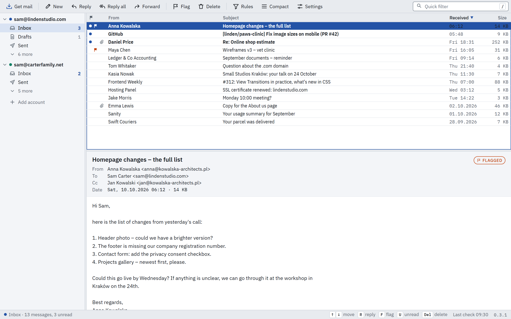

# Telex

A compact, keyboard-driven email client for Windows and Linux, in the spirit of The Bat!.
Built with Rust and Tauri: small installer, fast start, no Electron, no account.



> **Status: in daily use, before 1.0.** Telex syncs real mail over IMAP (SSL/TLS or STARTTLS,
> password login) both ways: a local, searchable mail base, with reading, flagging, moving and deleting mirrored to
> the server. It sends over SMTP (SSL/TLS or STARTTLS) through an Outbox that retries, and
> keeps a copy in Sent on the server. HTML mail shows in a sandbox where no script can run,
> with remote images blocked until you allow them. Rules sort, flag and answer new mail and
> leave a note saying why. Each account can have several identities, each with its own
> signature and reply templates. You write in plain text or, when it helps, in HTML (which goes
> out with a plain-text copy), and in a dark theme HTML mail takes the theme's colors. A Usage
> page shows each account's server storage and how its mail comes and goes. Release builds update themselves from GitHub Releases, but
> only check after you say yes (or click the version number). Adding an account takes a name,
> an address and a password: Telex finds the server settings itself. The message list loads a
> page at a time, so a mail base of 100,000 messages opens and scrolls as quickly as a small
> one, and search looks in one folder or in all your mail, suggesting people, operators and
> recent searches. Space reads on to the next unread message, and Settings › Reading decides
> when mail counts as read (or leaves it to you). The interface speaks English
> and Polish, down to its error messages, comes in eight themes that all meet WCAG 2.2 AA contrast (two at AAA), and its
> settings, rules and identities export to one file for another PC. Folders on this PC keep mail
> off the server (mbox and .eml in and out), and the mail base backs itself up. Moving in from
> Thunderbird or Outlook brings accounts, local mail (.pst too) and filters in one go; the spell
> checker uses Windows' dictionaries or Hunspell's; an away reply goes on the server where it
> speaks ManageSieve, and Telex sends it itself where it doesn't.

## Run it on Windows

You need:

1. **Rust**: install from [rustup.rs](https://rustup.rs) (default MSVC toolchain).
2. **Visual Studio Build Tools** with the "Desktop development with C++" workload.
3. **Node.js** 20 or newer.
4. **WebView2**: already on Windows 11.

Then, in the project folder:

```
npm install
npm run dev
```

The first build compiles all Rust dependencies and takes a few minutes; later starts take seconds.

To build installers (`.exe` and `.msi` in `target\release\bundle\`):

```
npm run build
```

Every push to `main` also builds the Windows installers on GitHub Actions. Download them from the
run's **Artifacts** section (`telex-windows`). These builds, like your own, can't update themselves.

## Run it on Linux

Install Rust and Node.js 20+, and the libraries Tauri needs (Debian and Ubuntu names):

```
sudo apt install libwebkit2gtk-4.1-dev libsoup-3.0-dev libayatana-appindicator3-dev librsvg2-dev libxdo-dev libdbus-1-dev patchelf
```

Then `npm install` and `npm run dev`, as on Windows; `npm run build` makes an AppImage and a
`.deb`. Passwords go to your keyring (GNOME Keyring, KWallet or another Secret Service), so one
has to be running and unlocked. Releases carry an AppImage that updates itself: `chmod +x` it and
run it.

## Releases and updates

Pushing a tag such as `v0.2.0` runs the **Release** workflow: it builds the Windows installers and
the Linux AppImage and `.deb`, signed for the updater, and a `latest.json` for both, and puts them
in a draft GitHub release. Publishing the draft makes
the update visible to every Telex that checks. Set the version first with
`npm run set-version -- 0.2.0`. The whole process, the one-time key setup and exactly what an
update check sends are in [docs/releasing.md](docs/releasing.md).

## Keyboard

| Key | Action | Key | Action |
|---|---|---|---|
| ↑ ↓ | move | R / Shift+R | reply / reply all |
| Space | read on, then the next unread | Shift+F10 | the message's menu (or right-click) |
| Home / End | first / last | Shift+F | forward |
| F | flag | N | new message |
| U | toggle unread | Del / Z | delete / undo |
| / | search | Ctrl+Enter | send |
| Tab (in the filter) | this folder / all mail | Enter | open an all-mail result in its folder |
| Ctrl+, | settings | Ctrl+= / Ctrl+− / Ctrl+0 | larger / smaller / normal text |
| H | HTML / plain text view | Ctrl+B / I / U / K | bold / italic / underline / link (HTML compose) |
| M / G | move to / go to a folder | E | edit a draft or unsent message |
| T | the conversation | O | only unread |
| Shift+U | mark the folder read | F7 | the next spelling mistake (compose) |
| F2 | rename a folder on this PC | ? / F1 | every key |

## Project layout

- `crates/telex-core`: the mail engine in Rust, with tests (`cargo test -p telex-core`).
- `src-tauri`: the desktop app shell that connects the engine to the window.
- `ui`: the interface in plain HTML, CSS and JavaScript; themes in `themes.css`, English and Polish in `i18n.js`.
- `scripts`: `check-contrast.mjs` (every theme meets WCAG 2.2) and `check-i18n.mjs` (every text has its Polish), both run in CI.
- `docs`: [releasing](docs/releasing.md) a version, and the [storage plan](docs/storage.md).

See [CLAUDE.md](CLAUDE.md) for design principles, architecture and the roadmap.
